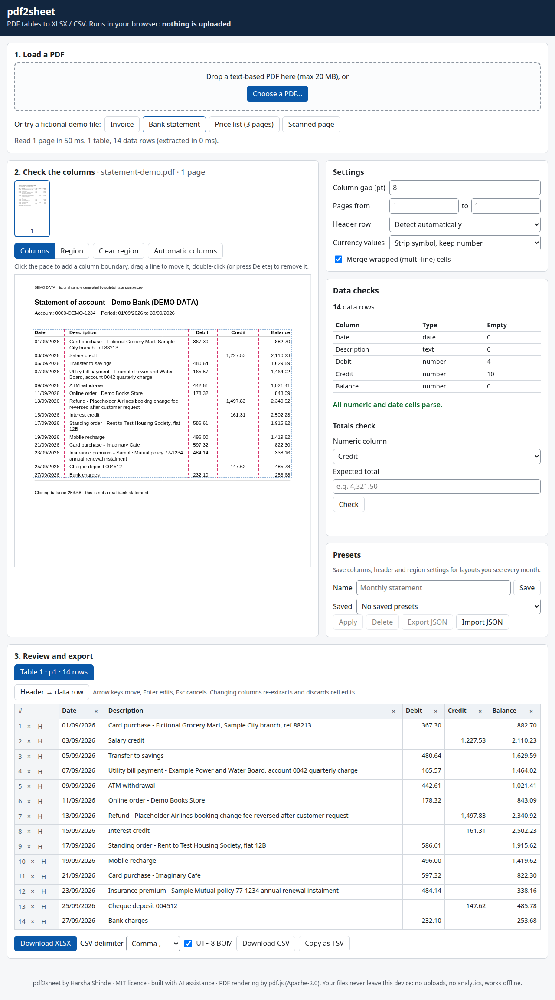

# pdf2sheet

Turn the tables in text-based PDFs (invoices, bank statements, price lists) into clean Excel or CSV files without retyping a single cell. pdf2sheet finds rows and columns automatically. You can drag the column lines to fix the layout, edit cells in a grid and check that totals add up, then download a typed XLSX (real numbers and dates, bold header, frozen top row) or a CSV. Everything runs in your browser from static files. **Your PDF is never uploaded**, and the app works offline.

**Live demo:** _not deployed yet._ It will go on GitHub Pages once the repository is made public. See [Deploying](#deploying-github-pages).



*Screenshot of the fictional `statement-demo.pdf` (DEMO DATA).*

## Features

- **Load:** drag and drop, or pick a `.pdf` up to 20 MB. Non-PDF, oversized and password-protected files get a clear inline error. Scanned PDFs (no text layer) are detected: *"No text layer found: this PDF looks scanned; OCR is not supported."*
- **Automatic table detection:**
  - multi-page tables are joined, and headers repeated on each page are removed;
  - wrapped (multi-line) cells are merged;
  - the header row is detected;
  - each page can hold several tables.
- **Fix it visually:**
  - column boundaries are drawn on the page preview. Drag a line to move it, drop it on a neighbour to merge two columns, click to add one, and double-click (or press Delete) to remove one. Boundary lines are also keyboard sliders (←/→, Shift for 10 pt);
  - limit extraction to a page range or a drawn region.
- **Editable grid:**
  - arrow keys move between cells, Enter edits, Esc cancels;
  - rename headers, delete rows or columns, promote a row to header (or demote it back).
- **Data checks:**
  - row count, empty cells per column and inferred type per column (number, date or text);
  - unparseable numeric or date cells are highlighted;
  - a totals check compares a column's sum with a total you type.
- **Number and date parsing:**
  - `1,234.50` → 1234.5, `(45.00)` → −45, `-12` → −12;
  - currency symbols are stripped by default, or kept as text if you choose;
  - `DD/MM/YYYY` and `YYYY-MM-DD` dates.
- **Export:**
  - XLSX with one sheet per table;
  - CSV with a `,`, `;` or tab delimiter, an optional UTF-8 BOM and RFC 4180 quoting;
  - **Copy as TSV**, which pastes straight into Excel or Google Sheets.
- **Presets:** save columns, header settings, region and page range under a name (kept in `localStorage`), and export or import them as JSON. A sample preset is in `samples/presets/statement-monthly.json`.

## Usage

The app is plain HTML, CSS and ES modules with no build step. ES modules don't load from `file://`, so serve the folder with any static server:

```bash
git clone <this repo> && cd pdf2sheet
python3 -m http.server 8080        # or: npx serve .
# open http://localhost:8080
```

Click one of the fictional demo files, or drop your own PDF.

## Development

Requirements: Node.js ≥ 22.13 and Python 3 (only to regenerate the samples).

```bash
npm ci                 # dev dependencies only: pdfjs-dist, playwright-core, axe-core
npm test               # node --test: unit and fixture tests (AC2–AC6, AC8–AC11, payload budget)
npm run smoke          # optional browser smoke test (see below)
npm run samples        # regenerate samples/*.pdf and samples/expected/*.csv (reproducible)
npm run vendor         # re-copy pdf.js from node_modules into vendor/pdfjs
```

`npm run smoke` serves the app locally and drives it in Chromium with Playwright. It checks:

- AC1: thumbnail strip and page count in under 3 s;
- AC2: the scanned-PDF message;
- AC6: dragging a boundary merges two columns;
- AC7: keyboard grid navigation, and axe-core reporting 0 serious or critical violations;
- XLSX and CSV downloads;
- the totals check;
- that no request leaves `127.0.0.1`;
- no horizontal overflow at 360 px.

It also refreshes `docs/screenshot.png`. Playwright needs a Chromium binary. Either run `npx playwright-core install chromium`, or set `CHROMIUM_PATH=/path/to/chrome`.

The LibreOffice test (AC9) runs when `soffice` is installed and is skipped otherwise. It converts the exported XLSX headless and checks the typed values.

### Project layout

```
index.html  styles.css
src/app.js        UI: loading, preview and boundary overlay, grid, checks, export, presets
src/extract.js    pure table extraction, number/date typing, data checks
src/xlsx.js       our own minimal SpreadsheetML writer (no SheetJS)
src/zip.js        store-only ZIP writer/reader with CRC-32
src/csv.js        RFC 4180 CSV/TSV writer and parser
src/presets.js    preset validation, JSON import/export, localStorage storage
vendor/pdfjs/     pdf.js 6.4.299 legacy build (Apache-2.0, LICENSE included)
samples/          fictional DEMO DATA PDFs, expected CSV, sample preset
scripts/          make-samples.py, vendor-pdfjs.mjs, smoke.mjs
test/             node --test suites
```

The app payload excluding pdf.js is about 84 KB (budget: 150 KB, enforced by a test).

## How it works

pdf.js reads the PDF's text layer: every text run comes with its position and font size. `src/extract.js` then works only with geometry:

1. **Rows.** Text items are sorted by baseline. An item joins the current row if its baseline is within **0.5 × the median glyph height** of the row. Items in a row that touch, or are less than half a glyph apart, are joined into one *segment* (pdf.js sometimes splits a single cell).
2. **Table runs.** Consecutive rows form a run until there is a vertical gap of more than 2.5 × the glyph height. Single-segment rows at the edges of a run, such as titles, footers and the "DEMO DATA" label, are trimmed. A run needs at least two multi-cell rows to count as a table.
3. **Columns.** The segments' x-start positions are sorted and clustered. A segment joins the current column when its x-start is within the **gap threshold** (default 8 pt, configurable) of that column's x-starts, or when it starts inside the column's existing text span. The second rule keeps right-aligned number columns together even though their x-starts vary. Column boundaries sit in the middle of the white gutters between clusters. These are the lines you can drag, and every segment is assigned to a column by its centre.
4. **Wrapped cells.** A row that has text only in non-first columns, directly under a row whose first column is filled, is a continuation. Its text is appended to the row above.
5. **Header.** The first row (of the first two) whose filled cells are all non-numeric and non-date, with at least 2 filled cells, becomes the header.
6. **Pages.** A table at the top of a page continues the previous page's last table if it has the same column count and the same header (or none). Repeated header rows are dropped.

When you move a boundary, extraction re-runs with your boundaries instead of the clustered ones. This takes a few milliseconds for 120 rows, well under the 300 ms target.

## Limitations

- **No OCR.** Scanned or image-only PDFs are detected and reported, not converted.
- Password-protected PDFs are not supported.
- Tables without clear white gutters between columns, rotated text and right-to-left scripts may need manual boundaries, or may not extract well.
- `DD/MM/YYYY` is assumed for slash dates. `MM/DD/YYYY` dates stay as text unless they are also valid as `DD/MM` dates.
- Manual boundaries apply to every page in the selected range. Use the page range or region to target one layout at a time.
- Editing cells and then changing columns re-extracts and discards the cell edits.

## Privacy

pdf2sheet has no server. The PDF is read with `File.arrayBuffer()` and processed in your tab. pdf.js, its fonts and the worker are served from `vendor/`, and nothing is loaded from a CDN. There are no analytics, cookies or tracking. A Content-Security-Policy restricts loads to the app's own origin, and the smoke test asserts that no request leaves it. Presets are stored only in your browser's `localStorage`.

## Notes on the spec

- **Node ≥ 22.13, not 20.** pdf.js releases before 6.2.108 have a high-severity advisory: arbitrary JavaScript execution when opening a malicious PDF ([GHSA-hq66-cqwq-w95j](https://github.com/advisories/GHSA-hq66-cqwq-w95j)). Every fixed release requires Node ≥ 22.13, and Node 20 has reached end-of-life, so the project pins pdf.js 6.4.299.
- The browser uses pdf.js's *legacy* build, because it bundles the polyfills that newer pdf.js code needs in Safari and older engines.

## Deploying (GitHub Pages)

The site is the repository root, so no build is needed:

1. Settings → Pages → *Deploy from a branch* → `main` / root.
2. Add the resulting URL to the "Live demo" line at the top of this README.

## Sample data

All files in `samples/` are **fictional DEMO DATA** generated by `scripts/make-samples.py`, which uses only the Python standard library and seeded random numbers, so the output is byte-for-byte reproducible. Every page is labelled "DEMO DATA". No names, amounts or references belong to real people or businesses.

## AI-assistance disclosure

This project was developed with AI assistance (Anthropic's Claude), under the direction of and with review by the author. The design, code, tests and documentation were produced in that collaboration. Behaviour is verified by the automated tests described above.

## Author and licence

**Harsha Shinde**. Released under the [MIT License](LICENSE). pdf.js © Mozilla, Apache-2.0.
